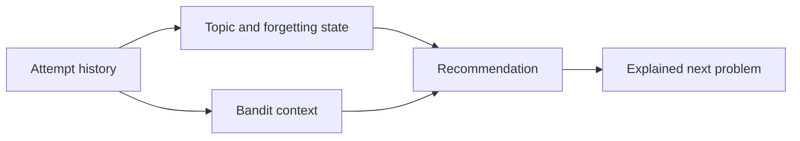
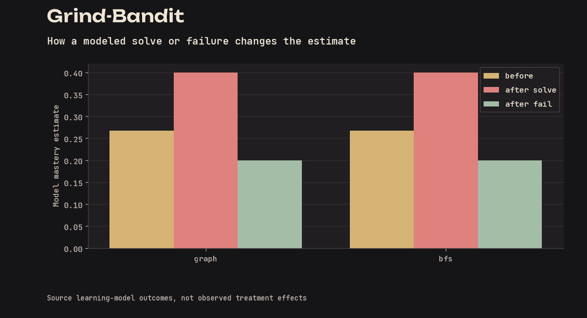

<p align="center"></p>

<h1 align="center">Grind-Bandit</h1>

<p align="center">
  <a href="https://github.com/FaiyazEnayet/grind-bandit/actions/workflows/ci.yml"></a>
  
  
  
</p>

<p align="center">
  <a href="https://faiyazenayet.github.io/grind-bandit/docs/dashboard.html"></a>
  <a href="#method"></a>
  <a href="#run-locally"></a>
</p>

Grind-Bandit recommends programming practice from logged attempts. It models topic mastery and forgetting, then explains why a particular problem is a useful next step.


<p align="center"><a href="https://faiyazenayet.github.io/grind-bandit/docs/dashboard.html"></a></p>


A practice recommendation should explain both its opportunity and its uncertainty. Compare topic estimates with recent attempts and the projected cost of waiting before choosing the next problem. Solving and failing update the learning model differently, so the recommendation is a revisable hypothesis about useful practice rather than a fixed judgment of ability.

## Explore

- Compare estimated mastery across 27 topics and inspect the evidence behind a recommendation.
- Switch recommendation samples and explore topic-level forgetting trajectories.
- Keep observed solve rate separate from model-estimated mastery.

## Method

Attempt history updates topic estimates and the bandit state. Recommendations combine estimated learning gain, uncertainty and difficulty fit. The dashboard exposes a reproducible scripted history rather than implying it is a real student study.

## Evidence at a glance

| Scope | Recorded result or contract |
| :--- | :--- |
| Problem bank | 218 hand-picked problems across 27 topics |
| Dashboard history | 30 scripted attempts with seed 42 |
| Interpretation | A reproducible demonstration, not a measured learning-outcomes trial |

## Updating this project

Dashboard source language: **Python**. Generator: `scripts/make_dashboard.py`. The local interactive output is `docs/dashboard.html`.

## Run locally


```sh
python -m pip install -e .
python -m pip install -r portfolio_ui/requirements.txt
python -m pytest tests -q
python -m grindbandit --help
python scripts/make_dashboard.py
```

## Technical design

The learner state separates problem attempts, topic estimates, logs and bandit parameters. Recommendations account for uncertainty and difficulty fit as well as expected learning gain. Forgetting reduces estimated mastery between practice events, so an old success does not imply permanently mastered knowledge.



## Evaluation protocol

The committed demonstration scripts a learner with different success tendencies across topics. That is useful for checking model behavior and reproducibility, but it is not a human-subject learning experiment. Recommendation changes should be checked against simple practice policies before being called better pedagogy.



A high topic estimate is a model belief informed by the logged history. The displayed solve rate is an observed fraction within the demonstration. They should not be equated, and uncertainty matters most during cold start and in sparsely attempted topics.

## Recommendation log and delayed quizzes

Every `next` pick is appended to the state file as a full recommendation record: the feature version (`context-v1`), the RNG seed behind the Thompson draw, the posterior and per-topic snapshot, and every candidate with its context vector and an estimated selection probability. The probabilities are Monte Carlo estimates from the model posterior (10,000 resamples on a separate RNG stream, add-one smoothed): they say how likely the model was to pick each problem, nothing more. Because the record is self-contained, any past pick can be replayed from its logged state and checked against what was actually recommended.

Logging an attempt also schedules a delayed transfer quiz: a different problem on the attempt's weakest topic, due three days later. Record its outcome with `grind-bandit quiz <id> solved|failed` (pending quizzes are listed by `stats`). Delayed outcomes are stored in their own part of the state file, separate from attempts and from the model-derived reward on each attempt (the change in modeled mastery, labeled `model_derived_mastery_change`). They never update mastery, the bandit posterior, or any reward. They are observational records, useful for later comparison, and are not causal evidence that a recommendation improved learning.

## Code and data

`src/grindbandit/bandit.py` owns recommendations. `mastery.py` handles learning and forgetting estimates. `state.py` stores attempts, recommendation records, and delayed quiz outcomes. The source problem bank and dashboard scripts remain inspectable.


## Limitations

- Cold-start recommendations depend heavily on priors.
- The forgetting half-life and difficulty thresholds are modeling choices.
- Easy-only histories can bias estimated learning gain. State saving also needs an atomic-write and relative-path fix.

## License

[MIT](LICENSE). Third-party datasets, libraries and fonts retain their own terms.
