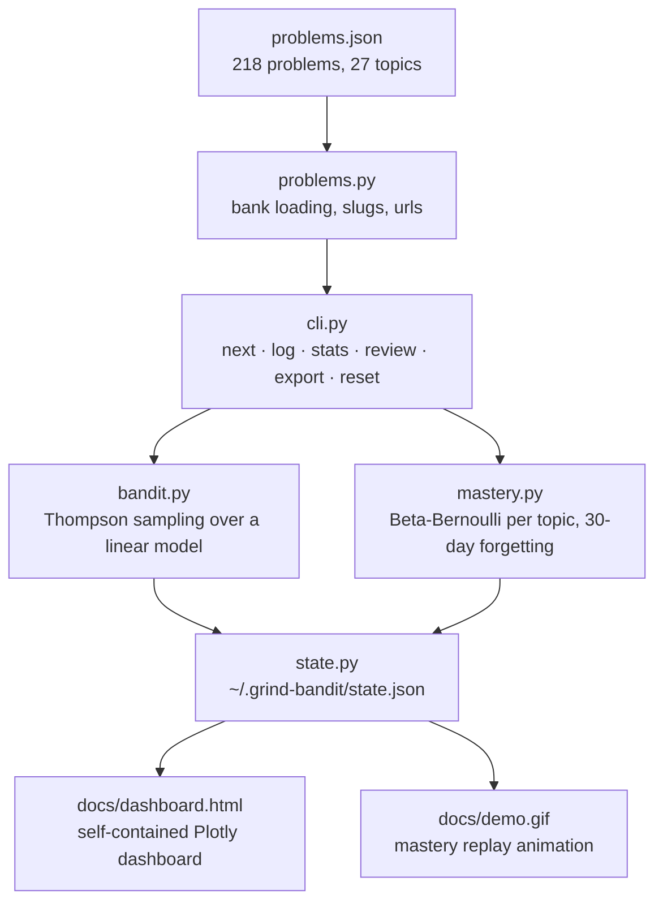

# grind-bandit


[](https://faiyazenayet.github.io/grind-bandit/docs/dashboard.html)

Your LeetCode grind as a contextual bandit.

Do you grind problems at random? Arrays on Monday, whatever felt easy on Tuesday. Does your DP stay bad for months? This is built for finding your next problem for you. It explores weak topics and exploits what is almost mastered. Bayes handles that tradeoff, not vibes.

## Live interactive demo

The dashboard below is a single self-contained HTML file. It runs the real engine, not a reimplementation. Open it for the full interactive version with Thompson sampling recommendations, forgetting projections, and the searchable problem bank.

[](https://faiyazenayet.github.io/grind-bandit/docs/dashboard.html)


The animation above replays the scripted demo session from the section below. Each frame is real engine output after one more logged attempt.

## How it works

Each topic gets a Beta Bernoulli skill model. A solve adds a win. A fail adds a loss. Mastery is the posterior mean. New topics start at 50 percent. That is maximum uncertainty, and the bandit treats it as an invitation.

Each problem gets a context vector with five features. The mastery gap on its weakest topic. The mean gap across its topics. Difficulty match. Days since those topics were last touched. A bias term. Difficulty match is the auto-adjustment. Below 40 percent mastery it scores Easy problems higher. Above 70 percent it reaches for Hard ones.

The bandit is Thompson sampling over a linear model of expected learning gain. It samples one theta from the Gaussian posterior and takes the argmax. The reward for an attempt is the mastery gain in the problem's weakest topic, clipped to [-1, 1]. Solving grows mastery, so the reward is positive. Failing shrinks it, so the reward is negative. The bandit learns which contexts produce learning, not just which problems get solved. There is no epsilon to tune.

Mastery forgets. Every read decays the stored win and loss counts exponentially toward the prior, based on days since the topic was last attempted. The half-life is 30 days and you can change it in the state file under `config.half_life_days`. The stored counts are never mutated, so the raw evidence stays intact. Stale topics sink back toward 50 percent and the bandit starts recommending them again.

Here is what forgetting looks like in practice. Eight straight solves in a topic, then nothing:

| days since last practice | mastery |
|---|---|
| 0 | 90% |
| 15 | 87% |
| 30 | 83% |
| 60 | 75% |
| 90 | 67% |
| 180 | 53% |

The bank holds 218 hand picked classics across 27 topics: 112 Easy, 96 Medium, 10 Hard. All counts are computed from the bank file at runtime, never hardcoded.

## Architecture



The CLI is the daily driver. The dashboard and the GIF are generated from the same engine by scripts in `scripts/`.

## Quickstart

```bash
pip install -e .
grind-bandit next
grind-bandit log 1 solved --minutes 25
grind-bandit stats
```

State lives in `~/.grind-bandit/state.json`. Set `GRIND_BANDIT_STATE` to move it.

## Regenerating the dashboard and GIF

The dashboard is committed as a single file, so it opens with no install. To regenerate it from the engine:

```bash
pip install plotly matplotlib
python scripts/make_dashboard.py   # writes docs/dashboard.html
python scripts/make_demo_gif.py    # writes docs/demo.gif
```

## A real session

I scripted a user who solves 90 percent of array and string problems and 30 percent of DP, graph, and backtracking ones. Thirty attempts logged over 13 days with a fixed seed, then:

```
$ grind-bandit next --seed 3
#994 Rotting Oranges (Medium)
https://leetcode.com/problems/rotting-oranges/
Topics: graph, bfs
Why this one:
  * weakest topic here: graph (mastery 27%)
  * last touched 6 days ago
  * broad room to grow across these topics
```

It found the weak topic and attacked it. The mastery view after those 30 attempts:

```
$ grind-bandit stats
Mastery heatmap (darker blocks mean stronger mastery):
+----------------------+----------------------+----------------------+----------------------+
| array                | backtracking         | bfs                  | binary-search        |
| ████████  83%      | ▒▒▒▒▒▒▒▒  34%      | ▒▒▒▒▒▒▒▒  27%      | ▓▓▓▓▓▓▓▓  66%      |
+----------------------+----------------------+----------------------+----------------------+
| bit-manipulation     | bst                  | design               | dfs                  |
| ▓▓▓▓▓▓▓▓  60%      | ▓▓▓▓▓▓▓▓  50%      | ▓▓▓▓▓▓▓▓  74%      | ▒▒▒▒▒▒▒▒  41%      |
+----------------------+----------------------+----------------------+----------------------+
| divide-conquer       | dp                   | graph                | greedy               |
| ▒▒▒▒▒▒▒▒  26%      | ▓▓▓▓▓▓▓▓  62%      | ▒▒▒▒▒▒▒▒  27%      | ▓▓▓▓▓▓▓▓  64%      |
+----------------------+----------------------+----------------------+----------------------+
| hash-table           | heap                 | intervals            | linked-list          |
| ▓▓▓▓▓▓▓▓  71%      | ▓▓▓▓▓▓▓▓  50%      | ▓▓▓▓▓▓▓▓  50%      | ▓▓▓▓▓▓▓▓  66%      |
+----------------------+----------------------+----------------------+----------------------+
| math                 | recursion            | shortest-path        | sliding-window       |
| ████████  86%      | ▓▓▓▓▓▓▓▓  64%      | ▓▓▓▓▓▓▓▓  50%      | ▓▓▓▓▓▓▓▓  50%      |
+----------------------+----------------------+----------------------+----------------------+
| stack                | string               | topological-sort     | tree                 |
| ▓▓▓▓▓▓▓▓  73%      | ▓▓▓▓▓▓▓▓  73%      | ▒▒▒▒▒▒▒▒  35%      | ▓▓▓▓▓▓▓▓  65%      |
+----------------------+----------------------+----------------------+----------------------+
| trie                 | two-pointers         | union-find           |
| ▓▓▓▓▓▓▓▓  66%      | ▓▓▓▓▓▓▓▓  71%      | ▓▓▓▓▓▓▓▓  50%      |
+----------------------+----------------------+----------------------+----------------------+

topic             mastery  tried   solved   last practiced
divide-conquer    ██░░░░░░░░ 26% 2       0%       1d ago
graph             ██░░░░░░░░ 27% 2       0%       6d ago
bfs               ██░░░░░░░░ 27% 2       0%       6d ago
backtracking      ███░░░░░░░ 34% 1       0%       2d ago
topological-sort  ███░░░░░░░ 35% 1       0%       8d ago
dfs               ████░░░░░░ 41% 3       33%      6d ago
heap              █████░░░░░ 50% 2       50%      10d ago
bst               █████░░░░░ 50% 0       0%       never
intervals         █████░░░░░ 50% 0       0%       never
shortest-path     █████░░░░░ 50% 0       0%       never
sliding-window    █████░░░░░ 50% 0       0%       never
union-find        █████░░░░░ 50% 0       0%       never
bit-manipulation  █████░░░░░ 60% 3       67%      today
dp                ██████░░░░ 62% 6       67%      2d ago
greedy            ██████░░░░ 64% 1       100%     12d ago
recursion         ██████░░░░ 64% 1       100%     9d ago
tree              ██████░░░░ 65% 1       100%     7d ago
linked-list       ██████░░░░ 66% 4       75%      7d ago
trie              ██████░░░░ 66% 1       100%     2d ago
binary-search     ██████░░░░ 66% 4       75%      1d ago
hash-table        ███████░░░ 71% 5       80%      3d ago
two-pointers      ███████░░░ 71% 5       80%      today
string            ███████░░░ 73% 9       78%      today
stack             ███████░░░ 73% 2       100%     7d ago
design            ███████░░░ 74% 2       100%     2d ago
array             ████████░░ 83% 10      90%      today
math              ████████░░ 86% 5       100%     today
```

And the weekly review on the same history. It replays the log to rebuild past mastery, so the trends are honest:

```
$ grind-bandit review --weeks 2
Weekly review: last 2 week(s)

week ending 2026-10-11: 16 attempts, 11 solved (69%), 542 min
  most improved: math (66% -> 86%)
  weakest now: divide-conquer (26%)

week ending 2026-10-04: 14 attempts, 12 solved (86%), 449 min
  most improved: array (50% -> 83%)
  weakest now: graph (34%)
```

## Commands

`next`: recommends one problem and explains why. `--seed` makes it reproducible.

`log`: records an attempt. Example: `grind-bandit log 322 failed --minutes 45`.

`stats`: mastery heatmap plus a per topic table with attempts, solve rate, and last practiced date.

`review`: weekly summary with attempts, solve rate, minutes, most improved topic, and weakest topic.

`export`: dumps history. `--format csv` or `--format json`, `--out` picks the file.

`reset`: wipes everything. It asks first unless you pass `--yes`.

## Testing

41 tests, all passing. They cover the bandit math, the forgetting model, the CLI roundtrips, and the dashboard and GIF generators.

```bash
pytest
```

## Honest limitations

The bandit needs about 20 logged attempts before the posterior beats the prior. Before that the picks are close to random. That is by design, but expect it.

The problem bank is 218 hand picked classics, not all of LeetCode. Coverage is good for interview prep and thin everywhere else.

The reward is mastery gain, which favors easy wins early. If you only log Easy solves, the bandit will keep feeding you Easy problems until the difficulty match feature catches up. Log honestly.

The 30-day forgetting half-life is my choice, not a measured fact about memory. Same for the 40 and 70 percent difficulty thresholds. They are sensible defaults, not science. Change them in the state file or the code if your experience says otherwise.

The dashboard shows a scripted demo history, not your real progress, unless you regenerate it against your own state file.

## License

MIT. See LICENSE.
